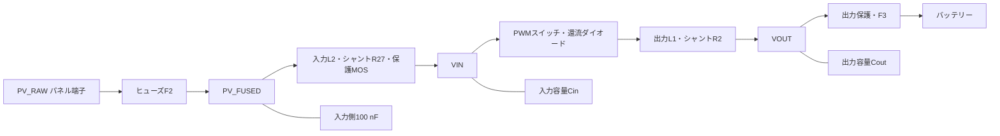

# c07の回路モデルと測定点

c07は、入力フィルタや保護経路を含む降圧充電回路の正常ONモデルです。保護MOSは導通、補助電源とADC基準電圧は確立済みとして計算します。

図の各容量はGNDへ接続します。実装にはバッテリー側と補助電源側の容量・ESRも含みます。

## 電圧・電流を区別する

| 表示・測定点 | 意味と用途 |
|---|---|
| PV_RAW | パネル端子の電圧。パネル端子電流と掛けて、回収電力・真のMPPを評価 |
| PV_FUSED | 入力ヒューズ後の電圧。通常の電圧PI/PIDとc07制御器が追従する測定点 |
| VIN | 入力L2後、Buckスイッチ手前の電圧。コイルへ加わる電圧の計算に使用 |
| 入力L2電流 | 入力シャントR27で測る電流。c07のMPPTと入力電流制限に使用 |
| 出力L1電流 | 出力コイルの電流。内側の電流PIに使用 |
| VOUT・電池電流 | 出力電圧制限と電池への充電を評価。L1電流とは出力容量の充放電分が異なる |

入力側の容量にも電流が流れるため、パネル端子電流とL2電流は瞬時には一致しません。L2電流とL1電流も異なります。Open-SEC型は測定位置の差からVINとPV_RAWを推定し、PV_RAWを電圧目標の評価点にします。

## 回路式へ入る値

入力L2を $i_2$、経路の直列抵抗を $R_2$ とすると：

$$
L_2\dot i_2=V_{PV\_FUSED}-V_{IN}-R_2i_2.
$$

L1は電流によって変わる微分インダクタンス $L_{diff}(i_L)$ を使います。ON時は：

$$
L_{diff}(i_L)\dot i_L=V_{IN}-V_{OUT}-(R_L+R_{on})i_L.
$$

OFF時はダイオードの電圧降下と抵抗を使い、電流が0になったら非導通にします。容量は $I_C=C_{diff}(V_C)\dot V_C$ で計算します。ESRを含む端子電圧と、コンデンサ内部電圧は別です。

代表値はL2 62 µH、Cin 1419.9 µF、L1は10.5 A時214 µH、Coutは51.2 V時約944.9 µF、電池開放電圧51.2 Vです。L1・Coutの設定値を変えると、保存したL/I・C/V曲線全体を倍率で変更します。CinとCoutの並列部品は等価容量・ESRへまとめています。

「電池側総抵抗」は出力保護抵抗とF3抵抗を含みます。電池内部抵抗はこれらを差し引いた値で、正になる組合せが必要です。入力F2、R27、入力保護抵抗はそれぞれ入力経路の電圧降下に効きます。

センサRCは主回路の容量とは別の状態です。制御器にはRCとADCを通した値を渡し、性能評価には対応する物理節点の値を使います。

このモデルはゲート駆動、熱、故障遮断、SOC変化を含みません。正常ON時の制御比較と、実機の動作確認は別です。
